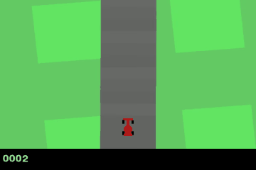
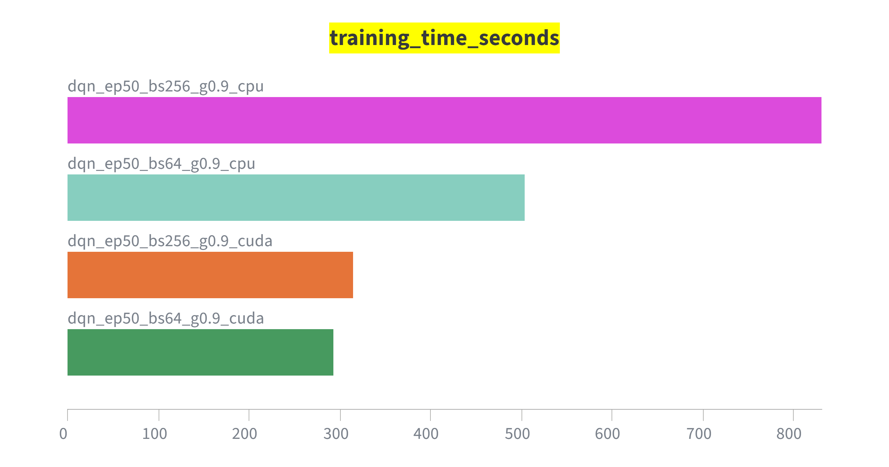
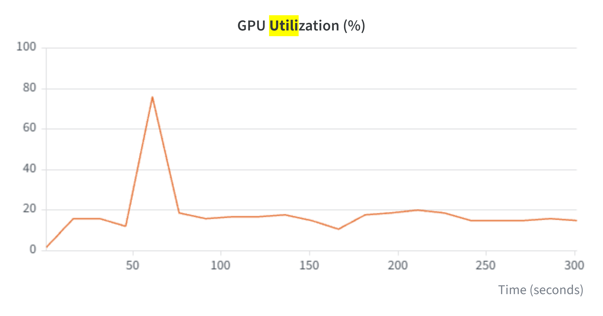
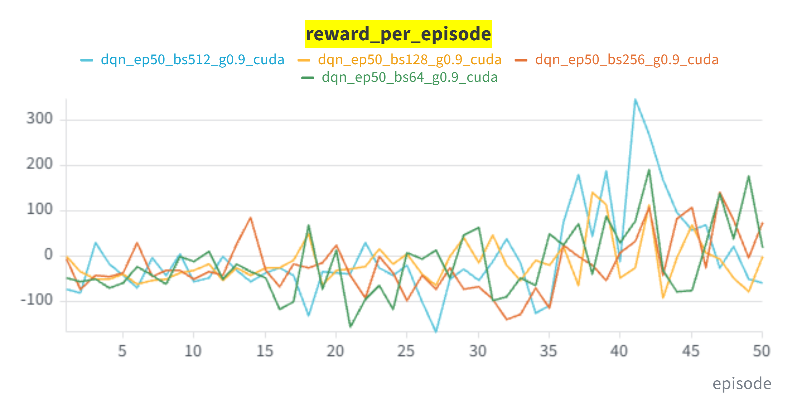
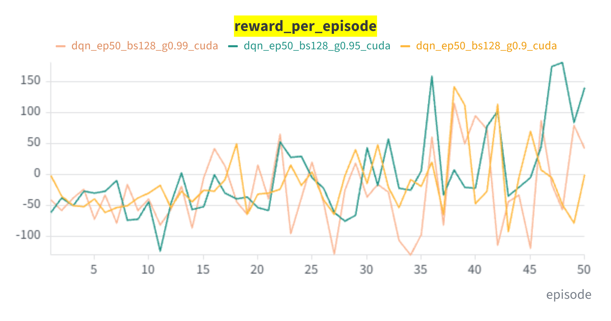
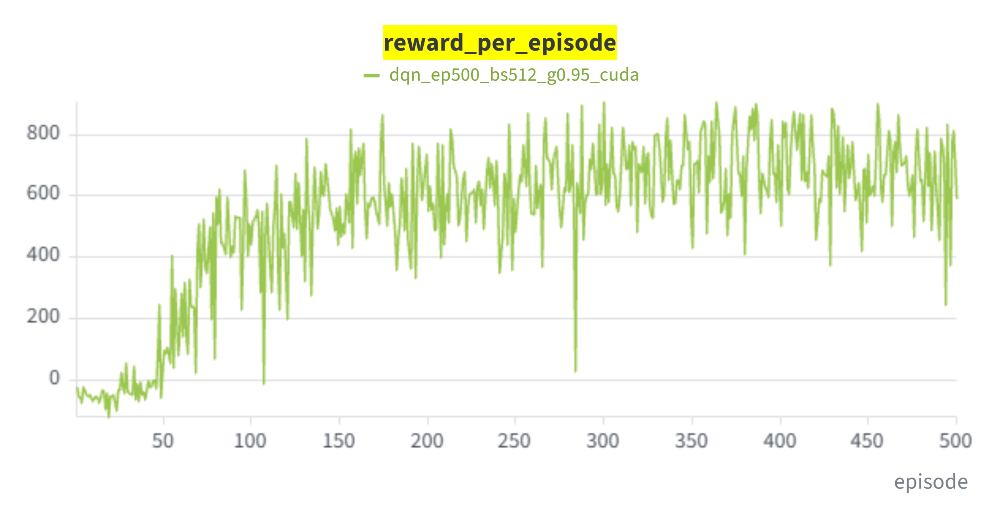
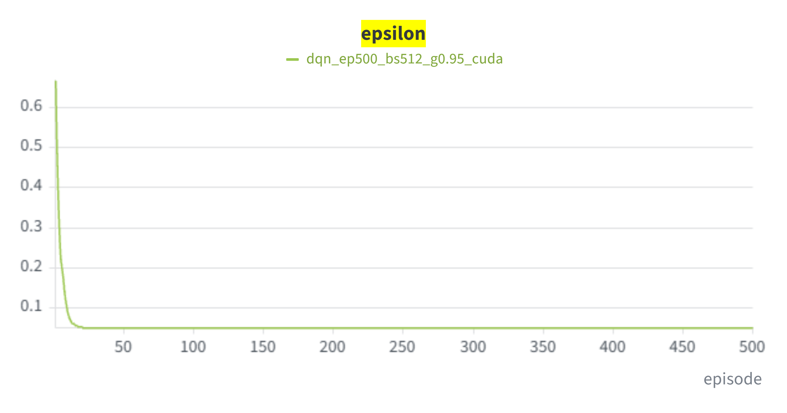

# Teaching a Car to Drive: DQN on CarRacing, CPU vs. GPU

*David Schell · 29.10.2026 · HCLab – GPU & Reinforcement Learning*

---

## 1. The problem

`CarRacing-v3` is a top-down racing game. The agent sees a 96×96 RGB image and needs to get around a randomly generated track. Each frame costs −0.1 reward, and every new track tile it reaches gives +1000/N (N = number of tiles). An episode ends after 1000 frames, or with −100 if the car leaves the playfield.

## 2. Setup

| | |
|---|---|
| GPU | NVIDIA GeForce RTX 5060 Ti (16 GB), driver 610.88 |
| CPU | AMD Ryzen 5 7500F 6-Core Processor |
| RAM | 32GB |

## 3. Tweaked Hyperparameters

| Hyperparameter | What it controls |
|---|---|
| `BATCH_SIZE` | Transitions per gradient update. Higher means smoother gradients but more compute per step. |
| `GAMMA` | Discount factor. Higher means the agent cares more about future reward. |
| `EPISODES` | Training length. |

All runs are logged to wandb: https://forge.coreweave.com/wandb/schelldavid-2003-leibniz-universit-t-hannover/car-racing-dqn

---

## 4. Experiment 1: CPU vs. GPU

Setup: γ = 0.90, episodes = 50

| Batch size | CPU time in seconds | GPU time in seconds | Speed-up | 
|---|---|---|---|
| 64 | 503.53 | 292.28 | 1.72× | 
| 256 | 830.98 | 314.82 | 2.64× | 

*Training time in seconds for all 50-episode runs. The two CPU runs stand out clearly.*

*wandb system panel: GPU utilization during a CUDA run. After a short spike at startup, it stays at only ~15–20 %.*

**Observations:**

- **The GPU is faster in both cases, but its advantage grows with batch size:** 1.72× at batch 64 and 2.64× at batch 256.
- **Batch size barely matters on the GPU.** Going from 64 to 256 samples per update makes a step only ~6 % slower (20.05 → 21.22 ms). On the CPU, the same change costs ~65 % more time (32.19 → 53.14 ms). Four times as much data per update is almost free for the GPU, while the CPU has to compute all of it.
- **The GPU is mostly idle.** Utilization stays at ~15–20 %. Most of the time goes to the environment (Box2D physics, rendering, OpenCV preprocessing) and Python batch assembly, which all run on the CPU. Gymnasium is not hardware-agnostic, so only the network benefits from the GPU.

## 5. Experiment 2: Batch size

Setup: GPU, γ = 0.90, episodes = 50.

*Reward per episode for batch sizes 64–512 (unsmoothed).*

| Batch size | Training time in seconds | Avg. reward (all 50 ep.) | Avg. reward (last 10 ep.) | Max reward |
|---|---|---|---|---|
| 64 | 292.28 | −13.7 | 49.3 | 191.2 |
| 128 | 293.36 | −13.9 | −5.7 | 142.4 |
| 256 | 314.82 | −19.5 | 56.4 | 141.2 |
| 512 | 340.24 | −2.2 | 90.6 | 348.3 |

**Observations:**

- **Cost:** going from 64 to 512 increases the training time by only 16 % (292 → 340 s), so large batches are cheap on the GPU.
- **Stability:** the average loss over the last 10 episodes drops steadily with batch size (0.174 → 0.083 → 0.054 → 0.038). Larger batches give smoother gradient estimates.
- **Reward:** batch 512 scored best (last 10 episodes: 90.6, best single episode: 348.3). The ranking is not monotonic, though (128 < 64 < 256 < 512). With one seed and 50 episodes, this is a trend, not proof.

## 6. Experiment 3: Discount factor γ

Setup: GPU, batch size = 128, episodes = 50.

*Reward per episode for γ = 0.90, 0.95 and 0.99 (unsmoothed).*

| γ | Effective horizon ≈ 1/(1−γ) | Training time in seconds | Avg. reward (all 50 ep.) | Avg. reward (last 10 ep.) | Max reward |
|---|---|---|---|---|---|
| 0.90 | 10 steps | 293.36 | −13.9 | −5.7 | 142.4 |
| 0.95 | 20 steps | 312.78 | −2.4 | 75.5 | 181.8 |
| 0.99 | 100 steps | 287.88 | −24.8 | −9.3 | 115.7 |

**Observations:**

- **γ = 0.95 worked best** (last 10 episodes: 75.5). It looks far enough ahead to plan for corners, but the targets stay stable.
- **γ = 0.90** is too short-sighted: about 10 decisions (≈ 30 frames) of look-ahead.
- **γ = 0.99** learned slowest. Rewards have to propagate back over ~100 steps through the bootstrapped targets, which takes more than 50 episodes. It might catch up in a longer run.
- γ does not change the compute per step, so the training times are similar (288–313 s).

---

## 7. Final agent

Configuration: batch size **512**, γ = **0.95**, **500** episodes on the GPU (the best values from experiments 2 and 3). Training time: **3744.86 s (62.4 min)**, i.e. 7.5 s per episode and 23.7 ms per step.

*Greedy policy of the trained agent (checkpoint after 500 episodes): it completes a full lap with a score of 904.*

*Reward per episode over 500 episodes (unsmoothed).*

| Episodes | Avg. reward | Max reward | Avg. loss |
|---|---|---|---|
| 1–50 | −30.1 | 245.3 | 0.028 |
| 51–100 | 351.6 | 685.3 | 0.054 |
| 101–200 | 551.7 | 864.3 | 0.071 |
| 201–300 | 624.6 | 906.5 | 0.073 |
| 301–400 | 687.1 | 905.1 | 0.090 |
| 401–500 | 683.9 | 900.8 | 0.100 |

*Exploration rate ε: it hits its minimum of 0.05 after ~20 episodes.*

**Observations:**

- **Fast breakthrough after episode 50:** the average reward jumps from −30 to 352 in episodes 51–100. The 50-episode runs from experiments 1–3 stopped right before this point.
- **Plateau from episode ~300:** the average stays at ~685, so more episodes bring little extra benefit with this setup. 49 episodes reached > 800, and 4 reached > 900 (best: 906.5 in episode 300).
- **Exploration ends early:** `eps_decay = 1000` is counted in steps, not episodes. ε is below 0.1 after only 10 episodes, so the agent learns almost entirely from its own greedy behavior.
- **The loss rises over time** (0.028 → 0.100). This is expected in DQN: as the agent collects higher rewards, the Q-values and therefore the TD errors grow, so the loss is no measure of how well the agent drives.

## 8. Conclusion

The GPU speeds up training by up to 2.64×, but it stays at ~15–20 % utilization because the Gymnasium environment and the Python batch assembly run on the CPU. That is also why larger batches are almost free on the GPU and were worth using. A slightly higher discount factor (γ = 0.95) helped the agent plan ahead for corners. With batch size 512 and γ = 0.95, the agent went from random driving to completing full laps (average reward ~685, best 906.5) in about one hour of training on an RTX 5060 Ti.

